# I run a gym SaaS on ₹0/month of compute. Here's the control plane that makes it work.

*Bro, I'm not paying for servers until I have to.*

I built gym management software: members, renewals, biometric attendance, WhatsApp reminders, invoices, the whole ERP. Then came the real question. **How do I host it for many gyms without paying for servers before the money comes in?**

My answer: free tiers. Lots of them. And one small app on top that manages them all. That app is the **control plane**. I call it the Control Panel.

Right now **4 gym customers run on one cluster**, and it's working smooth. Hosting bill: zero.

---

## The trick: a "cluster" is just three free accounts

Each free tier on its own is small. But one Vercel + one Supabase + one Render account together can run a full copy of the app for about 5 gyms.

| Piece | Free service | What it does |
|---|---|---|
| The app | **Vercel** | Every screen, sign-in, and the address the biometric machines push punches to |
| The database | **Supabase** (Postgres) | All the gyms' data in one database, each row tagged with its `gym_id` |
| WhatsApp sender | **Render** | Keeps each gym's WhatsApp linked and sends the queued messages |

That set of three is a **cluster**. When cluster-1 fills up, I make three new free accounts and add cluster-2. Then cluster-3. You scale out by adding more free accounts, not by upgrading one big server.

If you come from DevOps: think of each cluster as a node pool. The control plane is the scheduler and API server sitting on top.

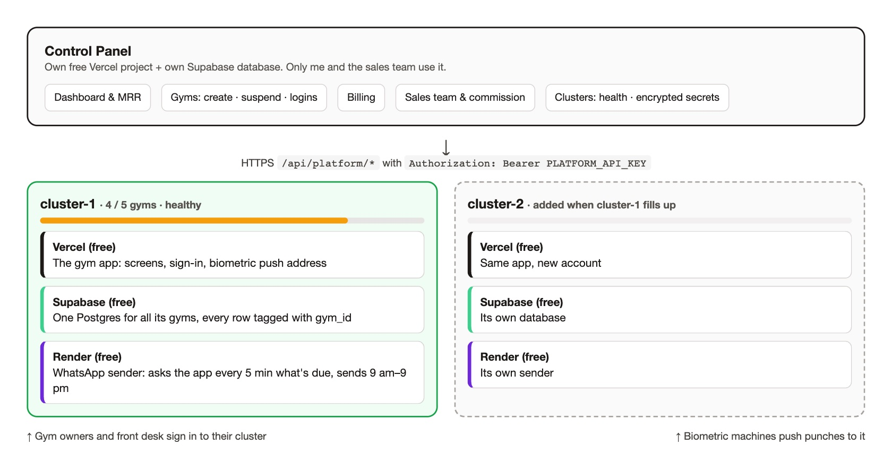

---

## What the Control Panel does

It's a separate small Next.js app (`control/` in the repo) with its own free Vercel project and its own Supabase database. Gyms never see it. Only me and my sales team use it.

### 1. One screen for the whole business

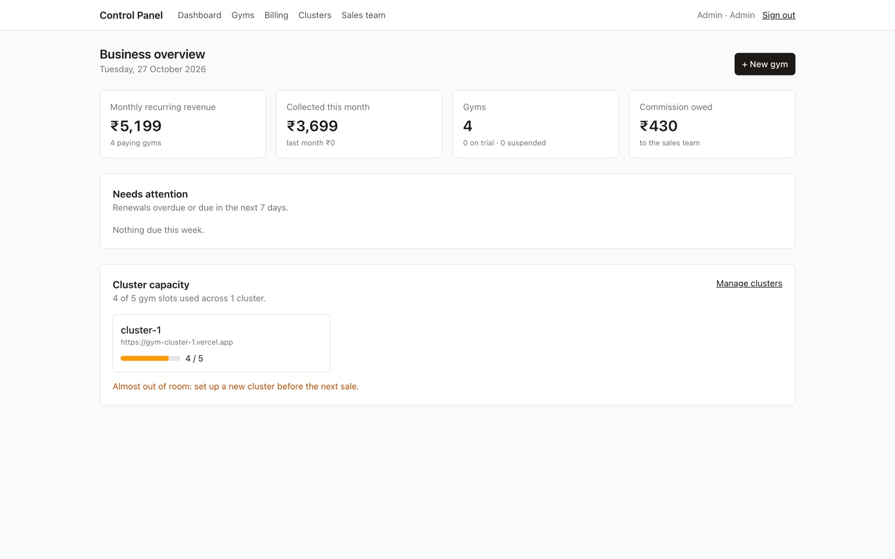

Monthly recurring revenue, money collected this month, how many gyms, commission owed to the sales team, and **how much room is left on each cluster**. At 4 of 5 it already warns me: *"set up a new cluster before the next sale."* No surprise "out of capacity" moments.

### 2. Clusters, with live health

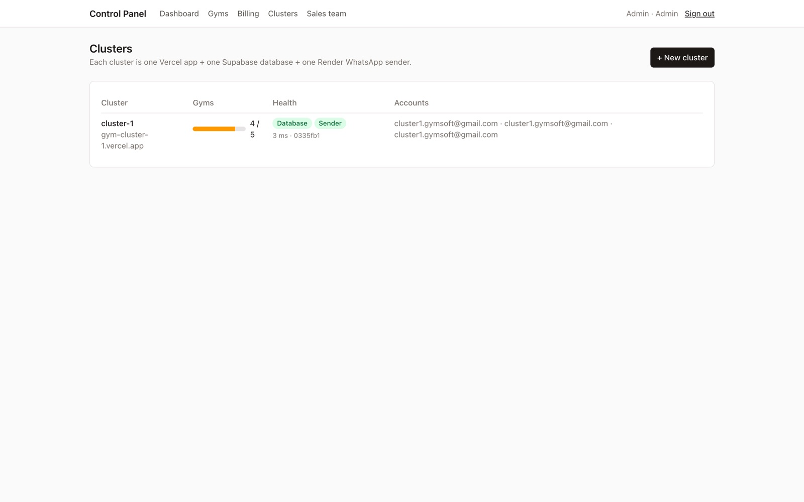

Every cluster lists its gyms, its health (database, WhatsApp sender, response time, deployed version), and which free accounts it runs on.

Open one and you see everything live from that deployment:

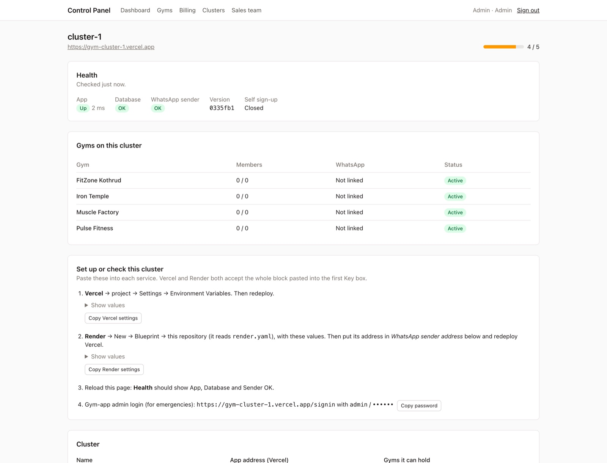

The Control Panel calls the cluster's `/api/platform/status` and `/api/platform/gyms`, so the numbers come from the cluster itself, not from a copy I have to keep in sync.

### 3. Adding a new cluster takes about 10 minutes

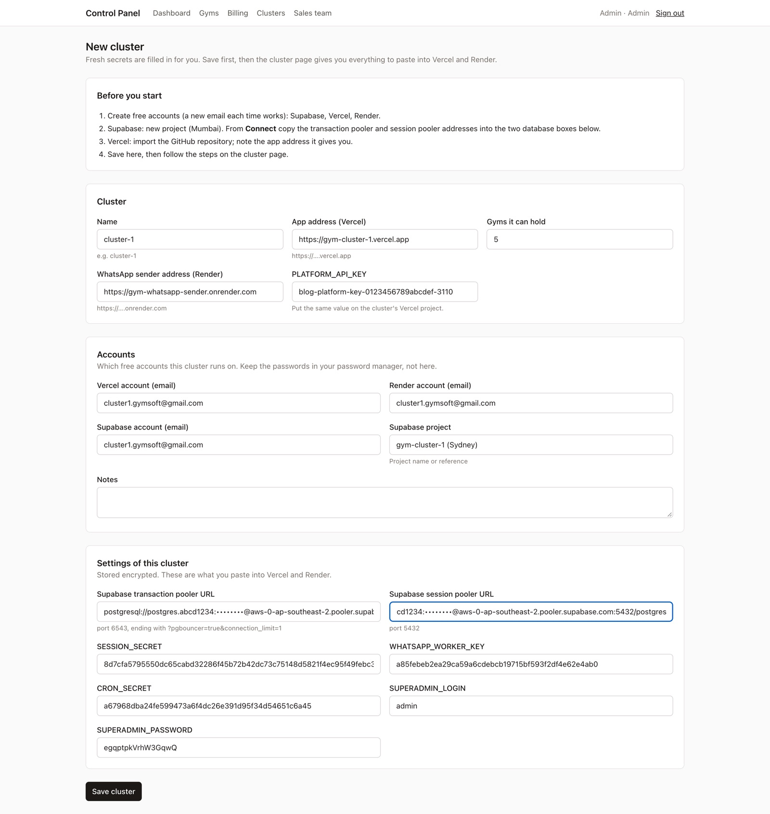

This was the part I hated doing by hand: making up secrets, copying database URLs, getting the same key into Vercel *and* Render without a typo.

Now:

1. Make free Vercel, Supabase and Render accounts.
2. Click **New cluster**. Every secret (`SESSION_SECRET`, `WHATSAPP_WORKER_KEY`, `CRON_SECRET`, `PLATFORM_API_KEY`, admin password) is already generated.
3. Paste in the two Supabase pooler URLs.
4. Click **Copy Vercel settings**, paste into Vercel, deploy. Click **Copy Render settings**, paste into Render's blueprint.
5. Reload. Health goes green. The cluster now shows up when I create a gym.

Every secret is stored **encrypted** (AES-256-GCM, keyed on one `CONTROL_SECRET`), so any cluster can be rebuilt or checked later without hunting through old notes.

### 4. Onboarding a new gym: one form

Sold a gym? Fill this in:

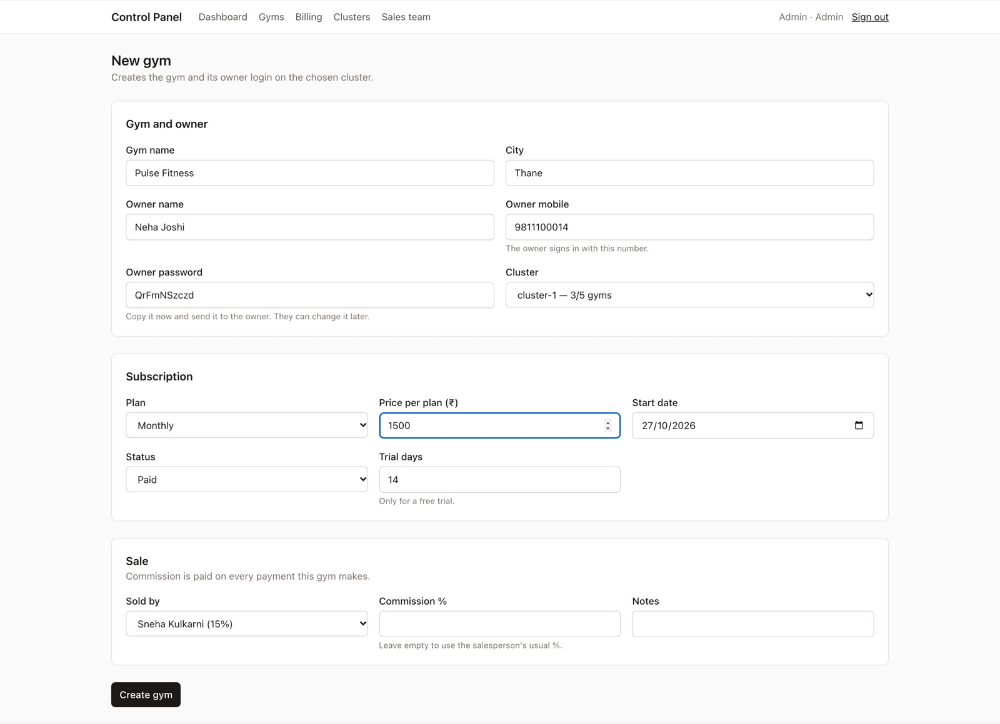

The cluster picker only offers clusters that are **up and have room**, emptiest first. Press **Create gym** and the Control Panel calls `POST /api/platform/gyms` on that cluster. In one database transaction the cluster creates:

- the gym,
- the owner's login,
- the default WhatsApp workflows (renewal reminders, birthday wishes, and so on).

If anything fails halfway, nothing is left behind. Then I get the login to send the owner:

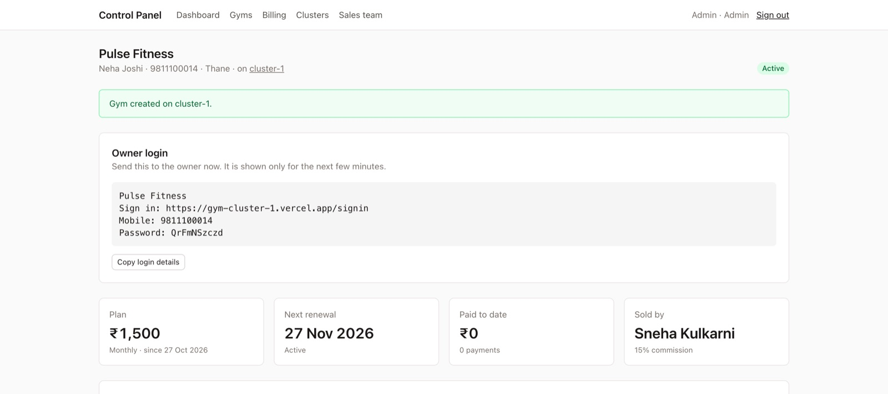

The owner opens the link, signs in, and lands in their own gym with a setup checklist:

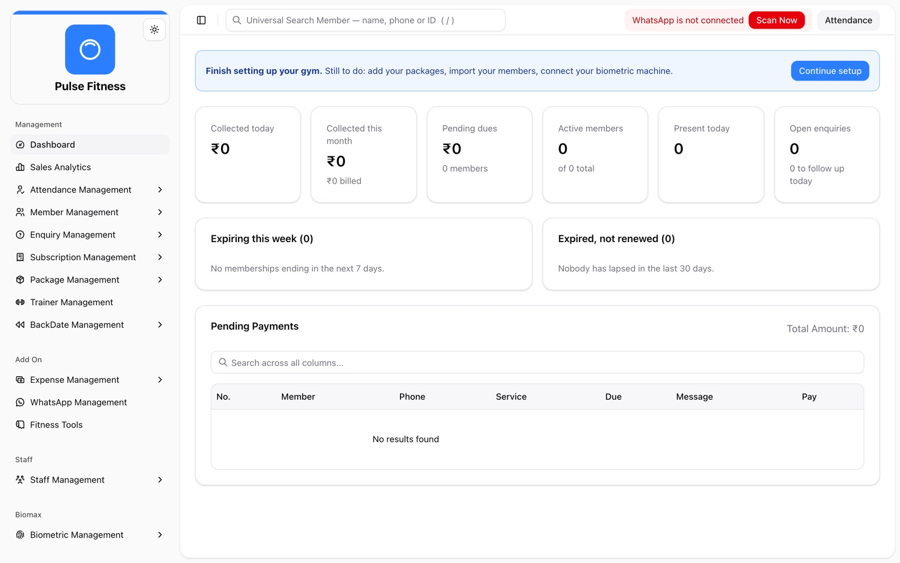

From "deal closed" to "owner is inside the software": **under a minute.** No deploy, no new database, no config change.

### 5. Gyms, billing and the sales team

All customers in one list, with plan, renewal date, who sold it, which cluster it's on, and live usage:

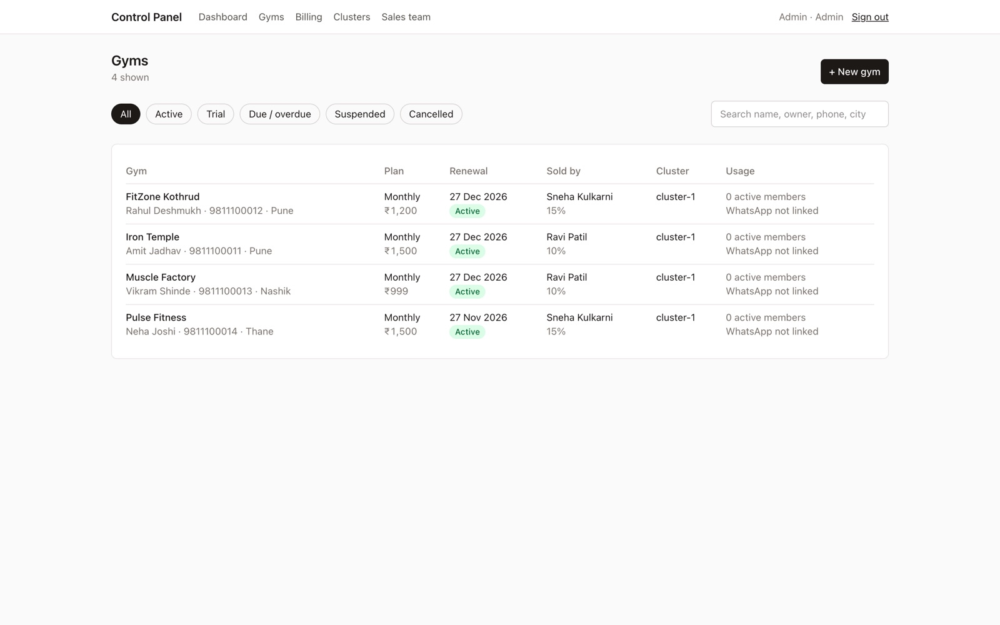

Salespeople get their own login. They see only the gyms they sold and their commission. Commission is booked automatically on every payment a gym makes:

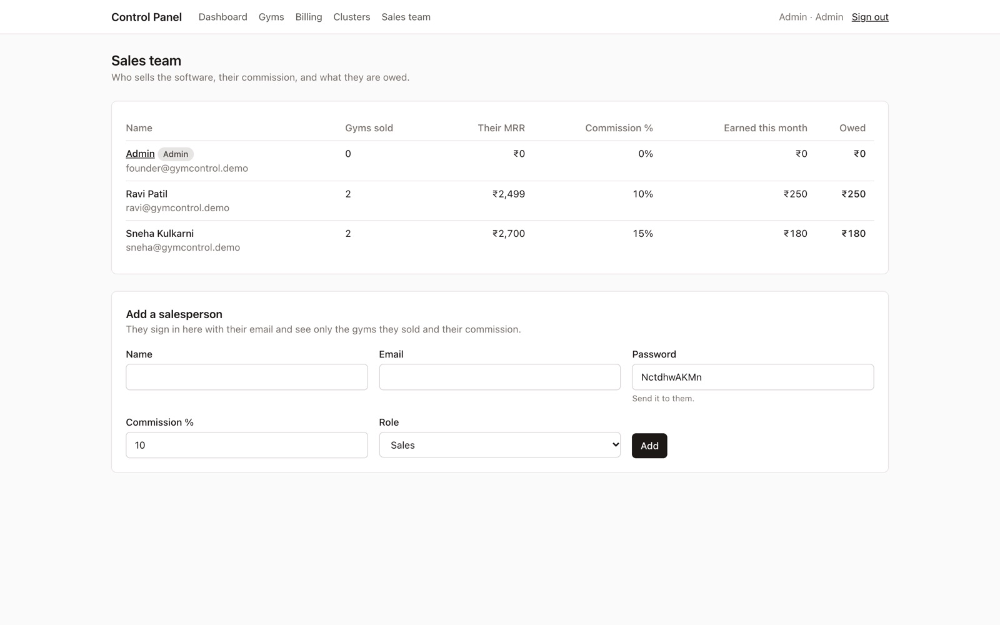

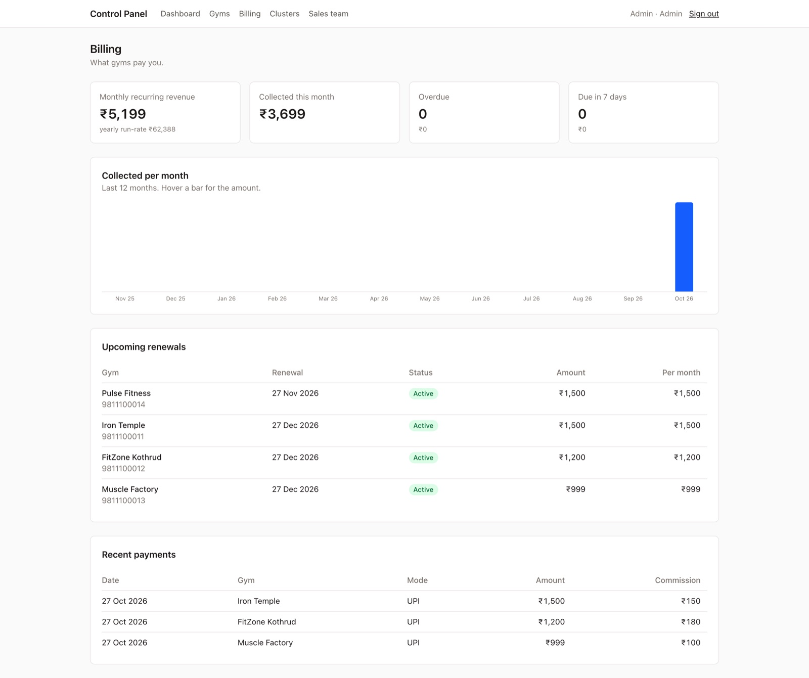

And when a gym stops paying: **Suspend**. Their sign-in is switched off on the cluster right away. They pay, I press **Resume**, they're back.

---

## How it fits together (for the nerds)

**Many gyms, one database per cluster.** Every gym-owned table has a `gym_id`. The app uses a tenant-scoped Prisma client (`src/lib/tenant.ts`) that adds the current gym to *every* query and refuses to run if no gym is known. One gym can't read another gym's rows, even if I write a buggy query.

**The control plane talks to clusters through one small API.** Each cluster exposes `/api/platform/*`, protected by a `PLATFORM_API_KEY` bearer token (compared in constant time). If that key isn't set, the API refuses everything.

| Call | Used for |
|---|---|
| `GET /api/platform/status` | Health: app, database, WhatsApp sender, version |
| `GET /api/platform/gyms` | Gyms with members, last activity, WhatsApp linked |
| `POST /api/platform/gyms` | Create a gym and its owner login |
| `PATCH /api/platform/gyms/<id>` | Suspend / resume, reset owner password |
| `…/gyms/<id>/logins` | Add, change or remove owner and reception logins |

**The WhatsApp sender is separate on purpose.** Vercel functions can't hold a long-lived WhatsApp connection, so the app only *queues* messages in the database. The Render worker keeps each gym's session open and sends them, 3–6 seconds apart, only between 9 am and 9 pm India time.

**Tricks to keep the free tiers happy:**

- Use Supabase's **pooler** connection strings. The direct one is IPv6-only on the free plan, and Vercel and Render can't reach it.
- Put Vercel's functions in the **same region** as Supabase (I'm on Sydney for both).
- Render's free plan sleeps idle services, so the sender pings itself every 10 minutes. A daily Vercel cron also wakes it as a backup.
- Supabase pauses projects after a week of no activity. Gyms check in members every day, so that never happens.
- Nightly encrypted database backups run on GitHub Actions. Also free.

---

## Where it stands

- **4 gyms live on cluster-1.** Health is green, members get their reminders on WhatsApp. Smooth.
- **Total hosting cost: ₹0.**
- **When gym #6 signs up**, I add cluster-2 in about 10 minutes and the Control Panel starts putting new gyms there.

### Caveats, so nobody @'s me

- **Vercel Hobby is for non-commercial use.** Once this is clearly a business, the Vercel side should move to Pro. The control plane makes that easy: it's per cluster.
- **Render free has 512 MB of memory.** Each linked WhatsApp session uses some, so I watch memory as gyms are added. That's the real reason a cluster holds ~5 gyms.
- **WhatsApp linking by QR is unofficial.** Sending too fast can get a number restricted, which is why the sender is slow on purpose.

The lesson: you don't need Kubernetes or a VPS to start a SaaS. You need a cheap unit you can copy (one cluster), and a small control plane that makes copying it boring.

Ship it, bro. 💪

---

*Screenshots are from a local copy of the Control Panel with demo gyms and test-only logins, set up the same way as production.*
